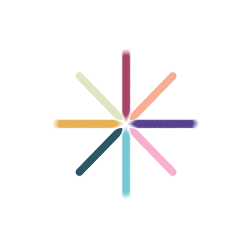

# unDavos

unDavos is a community-driven gathering in Davos during the week of the World Economic Forum's Annual Meeting each January. It puts meaningful exchange before scale: sessions, panels and encounters are co-created by the people who take part.

Website: [undavos.com](https://undavos.com)

## About this organisation

This is the GitHub home for the digital work behind unDavos: the website, the tools that help organisers, hosts and volunteers run the week, and the shared knowledge that carries from one edition to the next.

Most of our repositories are private, because they hold operational systems and community data. Only the people who need them have access. Anything we can share openly will appear here.

## For collaborators

If you work with unDavos, read the [unDavos GitHub Handbook](https://github.com/unDavos/.github/blob/main/CONTRIBUTING.md), then start in the repository you have been invited to and read its README first. Keep changes small, open a pull request, and ask a maintainer to review it before it is merged. Never push straight to `main`.

Live planning, tasks and decisions happen in the team's internal workspace, not on GitHub.

## Good practice

Keep personal data, credentials and sensitive operational material out of public repositories. Turn on two-factor login for your GitHub account. If you are unsure whether something can be shared, ask the unDavos core team before you publish it.
